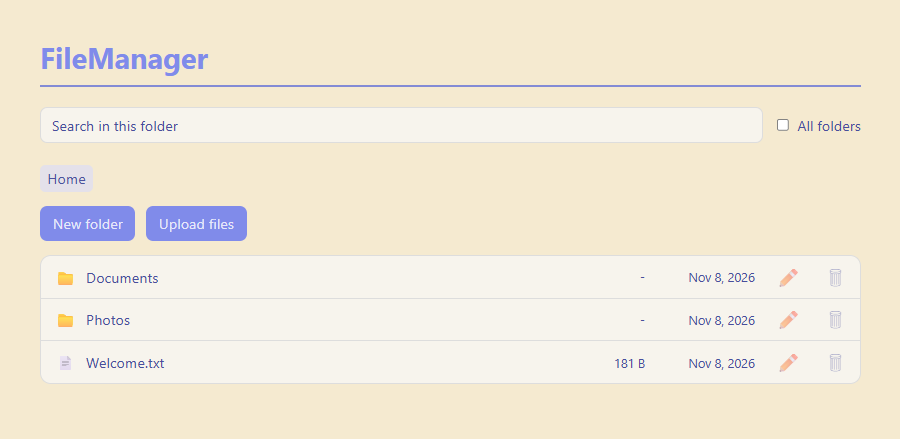

## File Manager
A web-based file manager built with Next.js and TypeScript. Files live on the
server's filesystem, so there is no database.



## Features

- Browse folders with breadcrumb navigation
- Upload files with a button or by dragging and dropping them in
- Download files, and preview images and text files without downloading them
- Create, rename and delete files and folders, with a confirmation before deleting
- Search the current folder or all folders at once
- Loading states that only appear when a request is slow
- Private sandbox per visitor, deleted automatically after 6 hours of inactivity

## Tech stack

- **App:** Next.js (App Router), React and TypeScript
- **Storage:** the server's filesystem through Node.js `fs`, no database
- **Tests:** Vitest
- **Packaging:** Docker and Docker Compose
- 
## Run it
You need Docker Desktop installed and running.

```
git clone https://github.com/ntomic7/FileManager.git
cd FileManager
docker compose up --build
```

Open http://localhost:3000.

Files are kept in a Docker volume named `storage-data`, so they survive
restarts. To remove all stored sandboxes, run `docker compose down -v`.

To run without Docker, you need Node.js 20 or newer:

```
npm install
npm run dev
```

Run the tests with `npm test`.

## Demo sandbox

There are no accounts. The first time you open the app, you get your own
sandbox containing a few sample files and folders. You can upload, rename,
delete and search freely. Nobody else can see your sandbox, and it is deleted
after 6 hours of inactivity. Your sandbox is tied to your browser, so
clearing cookies gives you a fresh one.

## Project structure

```
app/        pages, API routes (app/api/) and React components
hooks/      React hooks for folder loading, search and error messages
lib/        storage, sandbox and session logic, with unit tests
seed/       sample files copied into every new sandbox
```

## Design notes
- **Sandboxes instead of accounts:** each visitor gets a random UUID in an
  `HttpOnly`, `SameSite=Lax` cookie and their own folder on disk. The cookie
  value is checked against a strict UUID pattern before it is used to build a
  path, because a cookie is user-controlled data.
- **Path safety:** every path is resolved and must end up inside the visitor's
  sandbox. The check compares against the sandbox root plus a path separator, so
  a similarly named sibling folder does not pass. New names cannot be empty or
  contain `.`, `..`, `/`, `\` or null characters, and the sandbox root cannot
  be renamed or deleted.
- **Uploads and previews:** downloads are always sent as an attachment with
  `nosniff`. Only images and plain text can be previewed, text is served as
  `text/plain`, and SVG and HTML are not previewable. Uploads never overwrite
  existing files, and symbolic links are ignored.
- **Limits:** 50 MB per file, 100 MB per sandbox, at most 100 sandboxes at a
  time, and search results are capped at 200. Error messages never include
  server paths.
- **Cleanup:** expired sandboxes are removed when a request arrives (at most
  once every 10 minutes), so there is no background scheduler.
- **Tests:** unit tests cover the security-critical code, including the attack
  cases (`..`, absolute paths, sibling folders, null characters), sandbox ids,
  cleanup and the storage quota.
- **Cookie security:** the cookie is not marked `Secure`, because the app runs
    over plain HTTP locally and in Docker. Behind HTTPS it should be.
- **Not production-ready:** there is no rate limiting, and files are stored on
    the local disk, so it cannot run as several instances. Accounts, rate
    limiting and object storage (such as S3) would be the next steps.